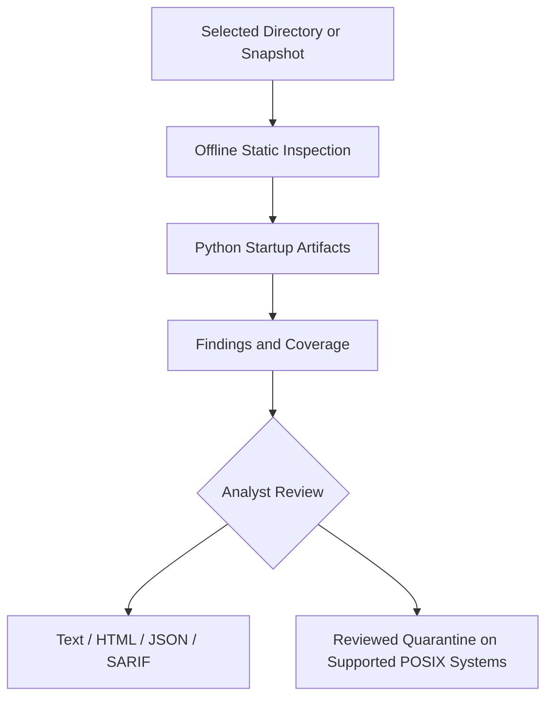
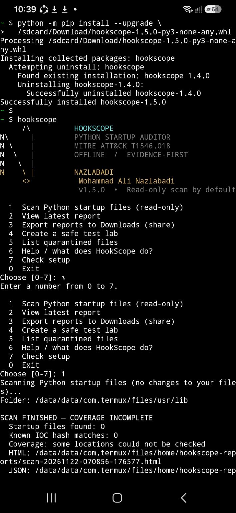

<div align="center">


# HookScope

### Python Startup Artifact Inspector

**Inspect what loads. Understand what matters.**

Offline-first inspection · Static analysis · Security investigation

---

A focused security tool for investigating Python startup artifacts and wheel packages without importing or executing inspected code.

Designed to help analysts identify, examine, and document potentially suspicious Python startup behavior.

[**Get Started**](#getting-started) · [**Documentation**](docs/QUICKSTART.md) · [**Latest Release**](https://github.com/moalinazli/HookScope/releases/tag/v1.5.0)

[Security](SECURITY.md) · [Contributing](CONTRIBUTING.md) · [License](LICENSE) · [Fieldbook](https://github.com/moalinazli/linux-persistence-fieldbook)

---

**HOOKSCOPE v1.5.0**

*Developed by Nazlabadi*

</div>

## Overview

Python startup mechanisms can influence interpreter behavior before an application begins executing its own code.

HookScope helps analysts investigate these mechanisms through offline artifact inspection.

The project is particularly relevant to investigations involving [MITRE ATT&CK T1546.018 — Python Startup Hooks](https://attack.mitre.org/techniques/T1546/018/).

### What HookScope does

| Capability | Description |
|:---|:---|
| Startup inspection | Inventories Python startup artifacts, including `.pth` and `sitecustomize.py` |
| Offline analysis | Inspects selected files without importing inspected Python code |
| Wheel inspection | Supports examination of Python wheel artifacts |
| Structured findings | Produces evidence for analyst review |
| Multiple reports | Text, HTML, JSON, and SARIF output |
| Coverage awareness | Reports incomplete scan coverage |
| Reviewed quarantine | Supports controlled file quarantine on supported POSIX systems |

> [!IMPORTANT]
> **A finding is an investigation lead, not proof of malware.**
>
> An empty result does not prove a system is clean. Interpretation depends on the selected scan root, accessible artifacts, coverage, and analyst review.

---

## How It Works



HookScope separates observation from remediation.

Ordinary scans do not modify the inspected target. Quarantine and removal are separate, explicitly reviewed operations.

---

## Platform Compatibility

**Version 1.5.0**

| Platform | Current status | Notes |
|:---|:---|:---|
| Linux | Verified path | Python 3.13 |
| Windows | Experimental | Installation and synthetic scan smoke-tested; full suite fails |
| Android Termux | Not revalidated | Current device behavior unverified |

<details>
<summary><b>Read compatibility details before installation</b></summary>

### Python compatibility

Although the v1.5.0 wheel advertises Python 3.10+, CI found that it does not start successfully with Python 3.10.

Use **Python 3.13** for the verified Linux path.

### Windows compatibility

Windows installation and a synthetic scan passed a smoke test.

However, the full Windows test suite fails, including import-resolution and banner-output issues.

Windows scanning and reporting remain experimental.

Quarantine, restore, and purge are not supported on Windows.

### Android Termux

Real-device behavior has not been revalidated in the current publication run.

Follow the [Termux documentation](docs/TERMUX.md) and verify the available Python version.

</details>

---

# Getting Started

## 01 · Installation

The v1.5.0 release wheel has no third-party runtime dependencies.

You need Python, pip, and permission to read the selected inspection target.

Network access is needed for downloading the wheel, not for ordinary offline inspection.

<details open>
<summary><b>Linux — Verified Installation Path</b></summary>

Requires Python 3.13.

```bash
python3.13 -m venv .venv
. .venv/bin/activate

python -m pip install https://github.com/moalinazli/HookScope/releases/download/v1.5.0/hookscope-1.5.0-py3-none-any.whl

hookscope --version
hookscope
```

The final command opens the interactive interface when a suitable terminal is available.

</details>

<details>
<summary><b>Windows PowerShell — Experimental</b></summary>

```powershell
py -3.13 -m venv .venv

./.venv/Scripts/python.exe -m pip install https://github.com/moalinazli/HookScope/releases/download/v1.5.0/hookscope-1.5.0-py3-none-any.whl

./.venv/Scripts/hookscope.exe --version
./.venv/Scripts/hookscope.exe
```

Use explicit executable paths if the virtual environment is not activated.

Windows inspection and reporting are experimental. File quarantine and remediation are unsupported.

</details>

<details>
<summary><b>Android Termux — Device Verification Required</b></summary>

```bash
pkg install python

python --version

python -m pip install https://github.com/moalinazli/HookScope/releases/download/v1.5.0/hookscope-1.5.0-py3-none-any.whl

hookscope doctor
hookscope
```

Use Python 3.13 where available.

Actual Termux behavior depends on the device and installed packages and has not been revalidated for this publication.

See the [Termux guide](docs/TERMUX.md).

</details>

---

## 02 · Interactive Interface

Launch HookScope:

```bash
hookscope
```

The interactive interface requires a terminal.

For automated or non-interactive workflows, use explicit commands instead.

You can also inspect the available commands:

```bash
hookscope doctor
hookscope help scan
```

---

## 03 · Read-Only Inspection

Start with a directory or snapshot you are authorized to inspect.

A read-only copy is preferable when investigating potentially compromised environments.

### Basic scan

```bash
hookscope scan --root /path/to/snapshot --strict --format text
```

### Export an HTML report

```bash
hookscope scan --root /path/to/snapshot --strict --format html --output report.html
```

### Export JSON

```bash
hookscope scan --root /path/to/snapshot --strict --format json --output report.json
```

### Export SARIF

```bash
hookscope scan --root /path/to/snapshot --strict --format sarif --output report.sarif
```

### Available output formats

| Format | Intended use |
|:---|:---|
| Text | Quick terminal review |
| HTML | Human-readable investigation report |
| JSON | Structured analysis and integration |
| SARIF | Security analysis result exchange |

> [!NOTE]
> The `--strict` option returns exit code `2` when scan coverage is incomplete.
>
> Review scan completeness rather than interpreting missing findings as evidence of a clean system.

### Windows PowerShell

Using the virtual environment created earlier:

```powershell
$hs = "./.venv/Scripts/hookscope.exe"

& $hs scan --root "C:/path/to/snapshot" --strict --format html --output report.html

& $hs scan --root "C:/path/to/snapshot" --strict --format json --output report.json

& $hs scan --root "C:/path/to/snapshot" --strict --format sarif --output report.sarif
```

Windows results remain experimental.

---

## 04 · Synthetic Test Environment

HookScope includes synthetic example material for controlled inspection.

Clone the repository:

```bash
git clone https://github.com/moalinazli/HookScope.git
cd HookScope
```

Run an inspection against the supplied synthetic snapshot:

```bash
hookscope scan --root examples/synthetic-snapshot --strict --format html --output synthetic-report.html
```

The same relative snapshot path can be used from PowerShell.

These examples are synthetic and do not represent evidence of an actual compromise.

---

# Screenshots & Reports

## Real Android Termux Session

<div align="center">



<sub>Original HookScope v1.5.0 Termux screenshot. The visible scan is incomplete and does not establish a clean result.</sub>

</div>

---

<details>
<summary><b>View Real HTML Report — Version 1.4.0</b></summary>

<br>

<div align="center">


</div>

This screenshot comes from an earlier version and is not presented as evidence of v1.5.0 behavior.

</details>

### Understanding Findings

A report should be interpreted as investigative evidence.

Pay attention to:

- Selected scan root and coverage status.
- Artifact paths and accessible files.
- Reported hashes and static indicators.
- Severity classifications.
- Missing or inaccessible inspection targets.

Severity supports prioritization. It is not an automated malware verdict.

Read the [analysis assumptions and limitations](docs/ASSUMPTIONS.md).

---

# Reviewed Quarantine

HookScope provides separately controlled quarantine operations on supported POSIX systems.

Unlike ordinary scanning, quarantine modifies the selected file location.

**Always review the artifact before changing it.**

### Review findings

```bash
hookscope scan --root /path/to/snapshot --review
```

### List quarantined items

```bash
hookscope quarantine-list
```

### Verify quarantine state

```bash
hookscope quarantine-verify
```

### Restore a selected item

```bash
hookscope restore --id QUARANTINE_ID
```

### Permanently remove a selected quarantined item

```bash
hookscope purge --id QUARANTINE_ID
```

Replace `QUARANTINE_ID` with an identifier returned by `quarantine-list`.

> [!WARNING]
> **Quarantine is not a substitute for incident response.**
>
> Quarantine moves the selected file but does not remove associated modules or stop running processes.
>
> Purge permanently removes the selected quarantined file after separate confirmation.
>
> Use an isolated lab for initial testing. Windows file mutation is not supported.

For recovery considerations, filesystem constraints, vault requirements, and remediation guidance, see [REMEDIATION.md](docs/REMEDIATION.md).

---

# Troubleshooting

<details>
<summary><b>HookScope does not start</b></summary>

Check your Python version and environment.

```bash
python --version
hookscope doctor
```

The v1.5.0 wheel fails to start under Python 3.10 despite its package metadata.

For the verified Linux path, use Python 3.13.

</details>

<details>
<summary><b>Incomplete scan results</b></summary>

Run:

```bash
hookscope doctor
hookscope help scan
```

Verify the scan root and file permissions.

Inspect coverage warnings before drawing conclusions from the results.

</details>

<details>
<summary><b>Windows console or import problems</b></summary>

Some Windows console encodings can cause Unicode banner failures.

The full Windows suite also contains unresolved import-resolution failures.

Windows behavior remains experimental.

Review the project's [GitHub Actions](https://github.com/moalinazli/HookScope/actions) for available CI results.

</details>

<details>
<summary><b>Reinstall or update</b></summary>

To reinstall the same release, repeat the installation command with:

```bash
--force-reinstall
```

Check the [release page](https://github.com/moalinazli/HookScope/releases) before upgrading.

Do not assume a newer release has been tested on your platform.

</details>

<details>
<summary><b>Uninstall HookScope</b></summary>

Linux or an activated virtual environment:

```bash
python -m pip uninstall hookscope
```

Windows virtual environment:

```powershell
./.venv/Scripts/python.exe -m pip uninstall hookscope
```

Reports and quarantine data are separate and are not removed by pip uninstall.

</details>

---

# Release Integrity

## Version 1.5.0

Original published asset SHA-256 values:

```text
4abf598778963c0a7366a22d1e0945cf08ceba97611d41c21981193666e8e6ba  hookscope-1.5.0-py3-none-any.whl

63833a098968c97481e325dceabe217b0a4ea81407a00ded257ef1e42f830caa  HookScope-v1.5.0-GITHUB-CLEAN-SOURCE.zip
```

### Verify the wheel on Linux

```bash
sha256sum hookscope-1.5.0-py3-none-any.whl
```

Compare the resulting digest with the recorded release checksum.

The source archive automatically generated by GitHub for the release tag represents the original tagged commit.

For the separately attached source archive, use the published ZIP asset.

[View Release v1.5.0](https://github.com/moalinazli/HookScope/releases/tag/v1.5.0)

---

# Documentation

| Resource | Description |
|:---|:---|
| [Quickstart](docs/QUICKSTART.md) | First steps and basic usage |
| [Assumptions](docs/ASSUMPTIONS.md) | Inspection limitations and interpretation |
| [Remediation](docs/REMEDIATION.md) | Quarantine, restore, and recovery guidance |
| [Termux Guide](docs/TERMUX.md) | Android environment guidance |
| [Release Notes](RELEASE_NOTES.md) | Release information |
| [Security Policy](SECURITY.md) | Security reporting |
| [Contributing](CONTRIBUTING.md) | Contribution guidelines |
| [License](LICENSE) | Project licensing |

---

# Contributing

Contributions are welcome when they improve correctness, reliability, documentation, testing, or security boundaries.

Please read [CONTRIBUTING.md](CONTRIBUTING.md) before opening a pull request.

Use synthetic fixtures, preserve third-party licensing requirements, and keep parsing offline.

---

<div align="center">

## HookScope

**Inspect what loads. Understand what matters.**

*Offline inspection. Evidence-driven security analysis.*

---

**NAZLABADI**

[Repository](https://github.com/moalinazli/HookScope) · [Releases](https://github.com/moalinazli/HookScope/releases) · [Security](SECURITY.md) · [Contribute](CONTRIBUTING.md)

<sub>Built for careful investigation, reproducible evidence, and responsible security research.</sub>

</div>
