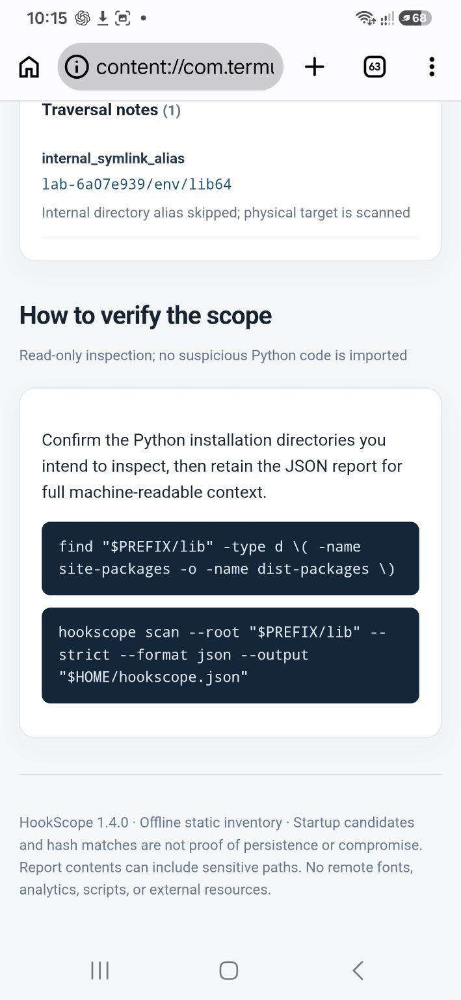

# HookScope

Offline inspection of Python startup artifacts and wheels. HookScope inventories files such as `.pth` and `sitecustomize.py` without importing the inspected code. It is intended to support an analyst's investigation of [Python Startup Hooks (T1546.018)](https://attack.mitre.org/techniques/T1546/018/).

[Release v1.5.0](https://github.com/moalinazli/HookScope/releases/tag/v1.5.0) · [Quickstart](docs/QUICKSTART.md) · [Limitations](docs/ASSUMPTIONS.md) · [Remediation](docs/REMEDIATION.md) · [Fieldbook](https://github.com/moalinazli/linux-persistence-fieldbook)

> **Compatibility notice:** The v1.5.0 wheel advertises Python 3.10+, but CI found that it fails to start on Python 3.10. Use Python 3.13 for the verified Linux path. Windows installation and a synthetic scan passed a smoke test, but the complete Windows suite fails, including import resolution and banner output; Windows support is experimental. Quarantine, restore and purge are not supported on Windows. Real Termux-device behavior has not been revalidated in this CI run.

A finding is an investigation lead, not proof of malware. An empty result is not proof that a system is clean. Scan completeness and the selected root matter.

## Install

The release wheel has no third-party runtime dependencies. Python 3.13, pip, and permission to read the target are needed. Network access is needed only for the download. Verify the [release asset checksums](#release-integrity) if required.

### Linux

```sh
python3.13 -m venv .venv
. .venv/bin/activate
python -m pip install https://github.com/moalinazli/HookScope/releases/download/v1.5.0/hookscope-1.5.0-py3-none-any.whl
hookscope --version
hookscope
```

The interactive menu requires a terminal. In a non-interactive session, use the explicit commands below.

### Windows PowerShell — experimental

```powershell
py -3.13 -m venv .venv
./.venv/Scripts/python.exe -m pip install https://github.com/moalinazli/HookScope/releases/download/v1.5.0/hookscope-1.5.0-py3-none-any.whl
./.venv/Scripts/hookscope.exe --version
./.venv/Scripts/hookscope.exe
```

Use the explicit executable path shown above when the virtual environment is not activated. The Windows scan and report path is experimental; do not rely on module resolution or remediation on Windows until the failing tests are resolved.

### Android Termux

```sh
pkg install python
python --version
python -m pip install https://github.com/moalinazli/HookScope/releases/download/v1.5.0/hookscope-1.5.0-py3-none-any.whl
hookscope doctor
hookscope
```

Use Python 3.13 where available; the device and current Termux package version were not tested in this publication run. See the [Termux guide](docs/TERMUX.md). A real v1.5.0 Termux screenshot follows; the visible scan is incomplete and must not be interpreted as a clean result.


## Scan and export

Choose a directory you are authorized to inspect. A read-only copy or snapshot is preferable for investigation. Ordinary `scan` does not modify the target. `--strict` returns exit code 2 when coverage is incomplete.

```sh
hookscope scan --root /path/to/snapshot --strict --format text
hookscope scan --root /path/to/snapshot --strict --format html --output report.html
hookscope scan --root /path/to/snapshot --strict --format json --output report.json
hookscope scan --root /path/to/snapshot --strict --format sarif --output report.sarif
```

PowerShell, using the environment created above:

```powershell
$hs = "./.venv/Scripts/hookscope.exe"
& $hs scan --root "C:/path/to/snapshot" --strict --format html --output report.html
& $hs scan --root "C:/path/to/snapshot" --strict --format json --output report.json
& $hs scan --root "C:/path/to/snapshot" --strict --format sarif --output report.sarif
```

Replace the sample paths with your own. Reports can contain sensitive paths and configuration details. Review coverage warnings, artifact paths, hashes and static signals before drawing conclusions. Severity is a triage aid, not an automated verdict. See [assumptions](docs/ASSUMPTIONS.md).

To try the included **synthetic** fixtures, clone this repository and run from its root:

```sh
hookscope scan --root examples/synthetic-snapshot --strict --format html --output synthetic-report.html
```

The same relative path works from PowerShell with `& $hs scan`. The [example reports](examples/) are synthetic; they do not demonstrate a real compromise.

<details><summary>Real HTML report screenshot — version 1.4.0</summary>

This image is from an earlier version and is not evidence of v1.5.0 behavior.



</details>

## Reviewed quarantine

On supported POSIX systems, review the exact finding and its source before moving a file. Use an isolated lab first; quarantine changes the selected file and requires confirmation. It does not remove associated modules or stop running processes.

```sh
hookscope scan --root /path/to/snapshot --review
hookscope quarantine-list
hookscope quarantine-verify
hookscope restore --id QUARANTINE_ID
hookscope purge --id QUARANTINE_ID
```

Replace `QUARANTINE_ID` with the ID printed by `quarantine-list`. Purge permanently removes the selected quarantined file after separate confirmation. Filesystem constraints, vault requirements, and recovery limitations are documented in [REMEDIATION.md](docs/REMEDIATION.md). Windows file mutation is unsupported.

## Troubleshooting and maintenance

- Run `hookscope doctor` and `hookscope help scan`. Confirm the selected root and read permissions; incomplete coverage is shown in the report.
- Python 3.10 fails to start in v1.5.0 despite the wheel metadata. Use Python 3.13 on Linux.
- A Unicode banner may fail on some Windows console encodings. Windows results are experimental; see [CI](../../actions).
- To reinstall this exact version, repeat the pip install command with `--force-reinstall`. Check the release page before updating.
- To uninstall, run `python -m pip uninstall hookscope` from the same environment; on Windows use `./.venv/Scripts/python.exe -m pip uninstall hookscope`. Reports and quarantine data are separate and are not removed by pip.

## Release integrity

For the two original v1.5.0 release assets:

```text
4abf598778963c0a7366a22d1e0945cf08ceba97611d41c21981193666e8e6ba  hookscope-1.5.0-py3-none-any.whl
63833a098968c97481e325dceabe217b0a4ea81407a00ded257ef1e42f830caa  HookScope-v1.5.0-GITHUB-CLEAN-SOURCE.zip
```

The tagged source-code archive generated by GitHub reflects the original release commit; use the separately attached source ZIP or the current browsable tree. [Release notes](RELEASE_NOTES.md) · [Security](SECURITY.md) · [License](LICENSE)
